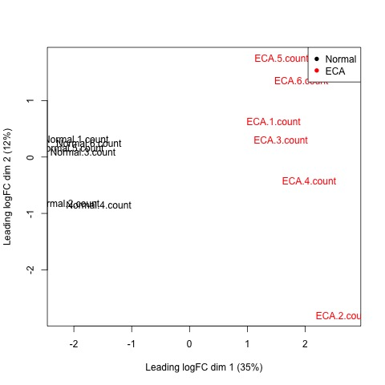
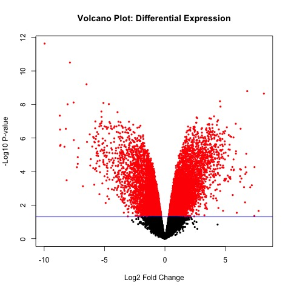

# C. RNA-seq expression analysis

This folder contains the analysis of the published GSE194116 gene-count matrix. The count matrix records how many sequencing reads were assigned to each gene in each sample.

## Pipeline

1. Low-count genes are filtered because very sparse counts provide little statistical evidence.
2. `edgeR` normalizes library-size differences and models count variability.
3. A paired design accounts for the patient while testing ESCC versus normal tissue.
4. The edgeR quasi-likelihood test produces differential-expression statistics.
5. `AnnotationDbi` and `org.Hs.eg.db` map Ensembl identifiers to Entrez identifiers.
6. `goana()` and `clusterProfiler` test which GO Biological Process terms are enriched.

## Files

- `Analysis_raw_count.Rmd` / `.html`: original RNA analysis code and rendered report.
- `results/`: primary edgeR result tables, diagnostic plots, and RNA GO results.
- `exploratory/`: preserved DESeq2 and limma result files and plots. These are supplementary analyses; edgeR is the primary RNA workflow.

Representative primary figures:

## Key results

- **7,305 of 24,315 genes** were reported as differentially expressed at FDR < 0.05.
- The result contained **3,780 upregulated** and **3,525 downregulated** genes.
- **2,066 GO Biological Process terms** were reported as significant after FDR correction.

Examples highlighted in the report include `CST1`, `KRT75`, `MMP11`, `P2RX2`, and `ADIPOQ` among the strongest differential-expression results.
