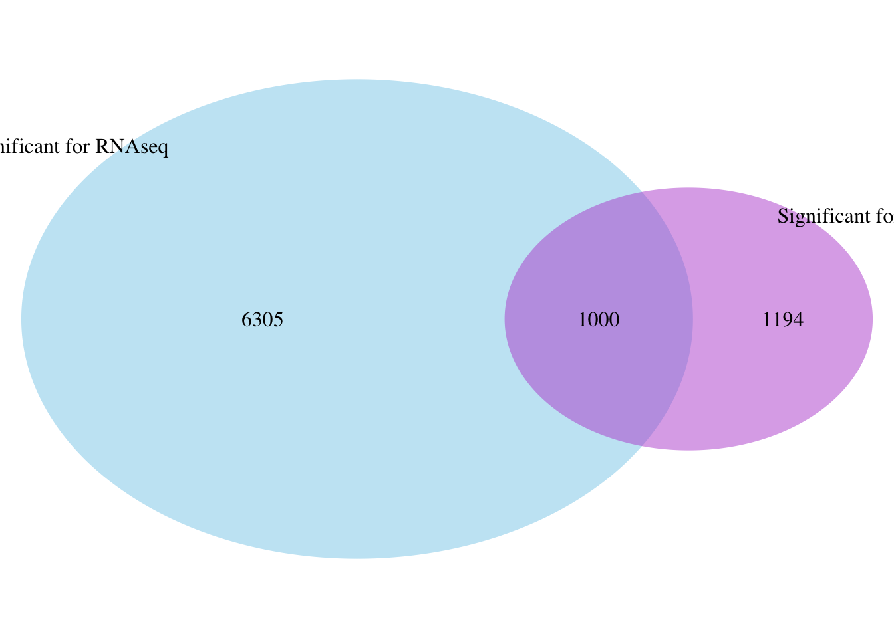
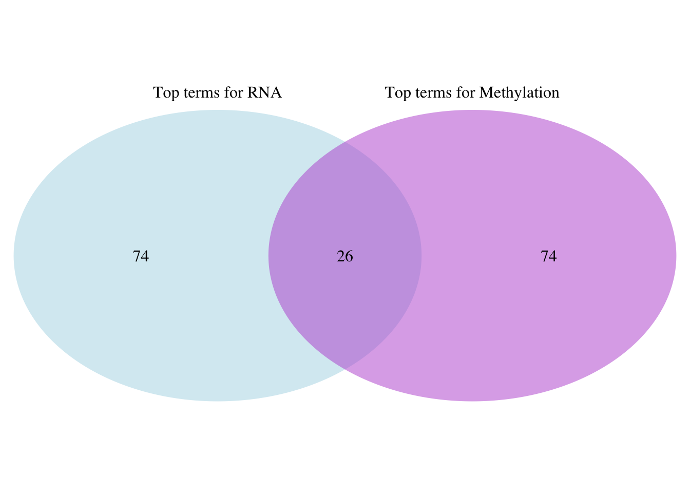

# D. Multi-omics integration

This folder combines the saved methylation and RNA results. It does not add methylation values to RNA counts. Instead, both analyses are mapped to common gene identifiers and GO terms.

## Comparisons

- RNA significant genes ∩ CpG-associated genes
- RNA significant genes ∩ DMR-associated genes
- RNA GO terms ∩ methylation GO terms

`Comparison.Rmd` and `Comparison.html` contain the original comparison code and report. `results/` contains the tables read by that notebook. The overlaps show which genes or biological processes appear in both omics analyses; they do not prove that one process causes the other.

The three extracted Venn figures from the rendered HTML report are in `figures/`. They show RNA/CpG overlap, RNA/DMR overlap, and RNA/methylation GO-term overlap. The HTML report remains the authoritative rendered record.

