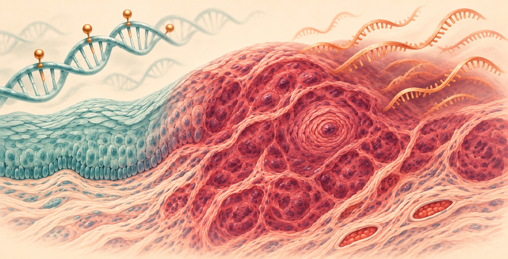
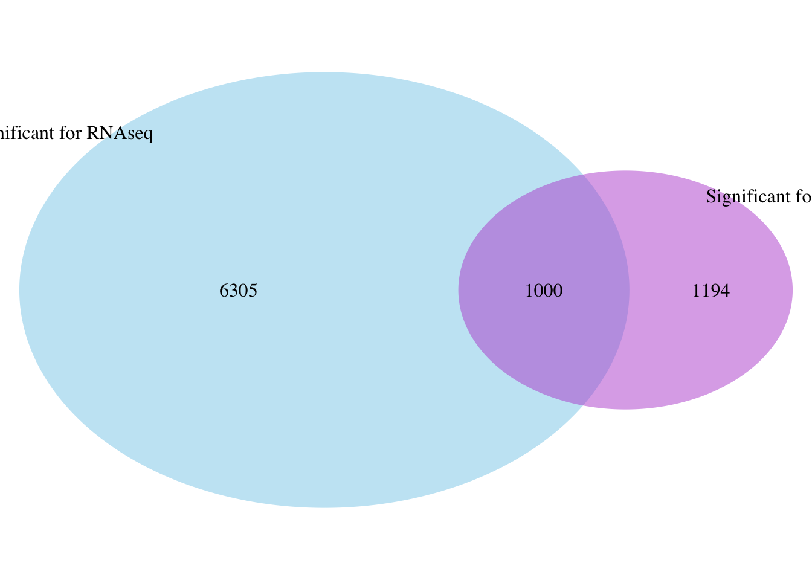
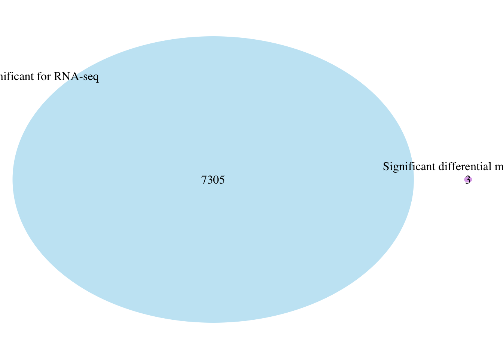
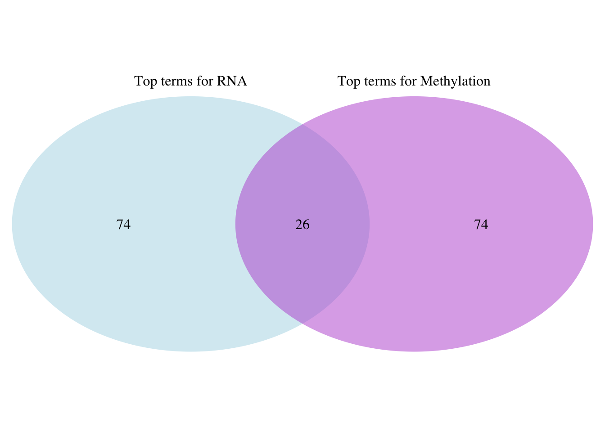

# Multi-Omics Analysis of DNA Methylation and Gene Expression in ESCC

This repository preserves the original R Markdown code, rendered reports, input tables, and analysis outputs from a course project on esophageal squamous cell carcinoma (ESCC). The project integrates DNA methylation and RNA-seq results to identify genes and biological processes altered in ESCC relative to adjacent normal tissue.

The four `.Rmd` files are preserved exactly as written in the original project. They have not been rewritten or silently corrected for this repository. Newly added documentation and reconstructed metadata are identified explicitly below.

<div align="center">

</div>

## Project objective

The project asks whether ESCC-associated changes in DNA methylation coincide with changes in gene expression. It has three analytical objectives:

1. Identify differentially methylated CpG sites and differentially methylated regions between paired ESCC and adjacent normal tissues.
2. Identify differentially expressed genes between paired ESCC and adjacent normal tissues.
3. Compare the methylation and expression results at the gene and Gene Ontology (GO) levels.

## Analysis outline: A–D

| Stage | Original code | Purpose |
|---|---|---|
| A. Data overview and QC | [`A_Data_Overview/`](A_Data_Overview/) | Describe the datasets, phenotype, paired design, count matrix, and preserved FastQC/MultiQC quality summary. |
| B. DNA methylation | [`B_DNA_Methylation/`](B_DNA_Methylation/) | `minfi`/ENmix QC and preprocessing → normalization → paired limma CpG analysis → annotation → bumphunter DMRs → GO. |
| C. RNA-seq expression | [`C_RNA_seq/`](C_RNA_seq/) | Count filtering → edgeR normalization and paired differential expression → Ensembl/Entrez mapping → GO. |
| D. Multi-omics comparison | [`D_Integration/`](D_Integration/) | Compare RNA genes with CpG-associated and DMR-associated genes, then compare RNA and methylation GO terms. |

Rendered HTML versions are included beside the original notebooks so the complete code and its recorded output can be reviewed without rerunning the analysis.

The project is presented in four folders: [`A_Data_Overview/`](A_Data_Overview/), [`B_DNA_Methylation/`](B_DNA_Methylation/), [`C_RNA_seq/`](C_RNA_seq/), and [`D_Integration/`](D_Integration/). The original root-level files and result folders are also retained as the original archive.

## Datasets

### DNA methylation: GSE157807

- Platform: Illumina Infinium HumanMethylationEPIC BeadChip.
- Samples: five ESCC tumors and five matched adjacent normal tissues.
- Design: paired; one tumor and one normal sample per patient.
- Original input: 20 IDAT files, one red and one green channel per sample.
- Genome annotation used in the notebook: `IlluminaHumanMethylationEPICanno.ilm10b4.hg19`.

| Patient | ESCC sample | Adjacent normal sample |
|---|---|---|
| 973 | GSM4775294 | GSM4775295 |
| 962 | GSM4775296 | GSM4775297 |
| 944 | GSM4775298 | GSM4775299 |
| 942 | GSM4775300 | GSM4775301 |
| 933 | GSM4775302 | GSM4775303 |

The phenotype used by the notebook is:

| Sample ID | Patient ID | Tissue type |
|---|---|---|
| GSM4775294 | ca-973 | ESCC |
| GSM4775295 | con-973 | NORMAL |
| GSM4775296 | ca-962 | ESCC |
| GSM4775297 | con-962 | NORMAL |
| GSM4775298 | ca-944 | ESCC |
| GSM4775299 | con-944 | NORMAL |
| GSM4775300 | ca-942 | ESCC |
| GSM4775301 | con-942 | NORMAL |
| GSM4775302 | ca-933 | ESCC |
| GSM4775303 | con-933 | NORMAL |

The submitted PDF prints `GSM4775320` once in the overview table for the ca-933 ESCC sample. The actual IDAT filename and the phenotype file used by the notebook are `GSM4775302`; the README follows the actual input used for analysis and records the PDF typo here.

The large IDAT files are not stored in Git. They are publicly available from [GEO GSE157807](https://www.ncbi.nlm.nih.gov/geo/query/acc.cgi?acc=GSE157807). The reconstructed phenotype and metadata are in [`A_Data_Overview/`](A_Data_Overview/); the reconstruction is explained in that folder's README.

### RNA-seq: GSE194116

- Platform: Illumina HiSeq 2500.
- Samples: six ESCC tumors and six matched adjacent normal tissues.
- Design: paired; one tumor and one normal sample per patient.
- Differential-expression input: the study-author-deposited raw gene-count matrix [`GSE194116_Raw_gene_counts_matrix.txt`](GSE194116_Raw_gene_counts_matrix.txt).
- Sample metadata: [`GSE194116_series_matrix.txt`](GSE194116_series_matrix.txt).

The original project performed FastQC on 11 of the 12 paired-end SRA runs and summarized the outputs with [`A_Data_Overview/fastqc/multiqc_report.html`](A_Data_Overview/fastqc/multiqc_report.html). SRR17686677 (ESCC-5, patient 271121) is absent from that preserved report. The complete SRR-to-GSM and patient mapping is documented in [`A_Data_Overview/metadata/rna_fastq_runs.tsv`](A_Data_Overview/metadata/rna_fastq_runs.tsv).

Kallisto quantification was considered, but the HPC environment was unavailable. The downstream RNA analysis therefore starts from the published raw gene-count matrix rather than a project-generated Kallisto matrix. The repository does not claim that Kallisto, Trimmomatic, or HISAT2 processing was completed by the project author.

## Pipeline at a glance

The figure above summarizes the project question, the two analysis branches, and the final integration result. Detailed methods and file-level explanations are provided in folders A–D.

```text
GSE157807 IDAT files
  -> raw-intensity inspection and QC
  -> ENmix background and dye-bias correction
  -> quantile normalization
  -> paired limma analysis of M-values
  -> significant CpG annotation and nearest-gene mapping
  -> GO analysis
  -> bumphunter DMR analysis (B = 500)

GSE194116 raw gene counts
  -> low-expression filtering
  -> edgeR normalization
  -> patient-aware paired design
  -> quasi-likelihood differential-expression test
  -> goana and clusterProfiler GO enrichment

Methylation genes/GO terms + RNA genes/GO terms
  -> RNA gene ∩ CpG gene
  -> RNA gene ∩ DMR gene
  -> RNA GO ∩ methylation GO
  -> Venn diagrams and candidate lists
```

The two omics datasets are not added as raw numerical values. Their results are connected through common gene identifiers and GO terms. This lets the project ask whether methylation-associated genes and expression-associated genes, or their biological processes, overlap.

## Methods and packages used in the original notebooks

The methylation notebook uses `minfi`, `ENmix`, `limma`, `IlluminaHumanMethylationEPICmanifest`, `IlluminaHumanMethylationEPICanno.ilm10b4.hg19`, `FDb.InfiniumMethylation.hg19`, `GenomicRanges`, and `ggplot2`. It also loads supporting or exploratory packages including `affy`, `ArrayExpress`, `GEOquery`, `biomaRt`, `tximport`, `tximeta`, and `minfiData`.

The RNA notebook uses `edgeR`, `limma`, `AnnotationDbi`, `GO.db`, `org.Hs.eg.db`, and `clusterProfiler`. The comparison notebook uses the saved Entrez ID and GO tables to generate overlaps with `VennDiagram`.

## Analysis process

### Methylation analysis

1. Raw red/green IDAT intensities and bead-level information were inspected.
2. Sample and CpG quality were assessed with `ENmix::QCinfo()`.
3. Background and dye-bias correction were performed with `preprocessENmix()`.
4. Methylation measurements were normalized with `norm.quantile(method = "quantile2")`.
5. M-values were modeled with `limma`; patient ID was used as a blocking factor and within-patient correlation was estimated with `duplicateCorrelation()`.
6. Differentially methylated CpGs were annotated with gene, genomic-feature, and CpG-island information.
7. Significant CpGs were linked to nearby genes, and GO Biological Process enrichment was assessed.
8. DMRs were detected with `bumphunter(cutoff = 0.25, B = 500, maxGap = 500)`.

### RNA-seq analysis

1. The deposited raw gene-count matrix was separated from Ensembl/gene-name annotation.
2. Low-count genes were filtered and library-size differences were normalized in edgeR.
3. A paired design matrix included tissue condition and patient identity.
4. Dispersion was estimated and a quasi-likelihood model was fitted with `glmQLFit()` and tested with `glmQLFTest()`.
5. Results were examined with MDS, BCV, volcano, MA, p-value histogram, and QQ plots.
6. GO Biological Process enrichment was evaluated with both `goana()` and `clusterProfiler::enrichGO()`; the clusterProfiler result was visualized as a top-category bar plot.

### Integration

1. Significant RNA results were filtered at FDR < 0.05.
2. Duplicated and missing Entrez identifiers were removed.
3. RNA genes were compared with genes associated with significant CpGs and DMRs.
4. The top GO terms from the RNA and methylation analyses were compared.
5. Common genes and processes were reviewed as candidates for joint transcriptional and epigenetic alteration.

## Major results reported in the submitted project

These are the results reported in the submitted project.

| Result | Reported value |
|---|---:|
| Differentially methylated CpGs | **35,994** (4.18%, adjusted p-value < 0.05) |
| Candidate DMRs | **6,885**; **3** significant at FWER < 0.1 |
| Differentially expressed genes | **7,305 / 24,315** at FDR < 0.05 |
| RNA up/down direction | **3,780 up**, **3,525 down** |
| Significant RNA GO Biological Processes | **2,066** |
| RNA/CpG-associated gene overlap | **1,000** |
| Shared RNA/methylation GO terms | **26** |

### Project question and conclusion

**Question:** Do ESCC-associated methylation changes coincide with changes in gene expression?

**Answer from this project:** ESCC showed broad methylation and expression changes. The strongest integration signal was at individual CpG-associated genes: **1,000 genes overlapped** with significant RNA genes. Significant DMR-associated genes showed **no overlap** with the RNA gene set, while the GO comparison found **26 shared biological processes**. The results support a shared epigenetic and transcriptional signal, but they do not establish a causal methylation-to-expression mechanism.

**Representative final figures:**

<div align="center"></div>

<div align="center"></div>

<div align="center"></div>

The stage-specific numbers and figures are documented in the README inside folders A, B, C, and D.

### Conclusion

The project found widespread methylation differences and widespread expression differences between ESCC and matched normal tissue. The integration step found overlap at both the gene and biological-process levels, suggesting that some ESCC-related processes may be reflected in both epigenetic and transcriptional changes. The comparison is an association analysis; it does not establish that methylation directly caused the expression changes.

### Limitations

- The paired cohorts are small: five methylation pairs and six RNA-seq pairs.
- The preserved MultiQC report is missing one of the 12 RNA-seq runs, and the original FASTQ files are not available in the project folder.
- Kallisto, Trimmomatic, and HISAT2 were considered but were not completed as a project-generated upstream workflow; RNA analysis starts from the published count matrix.
- The integration compares gene and GO overlap. It does not test causal regulation or validate methylation-expression relationships experimentally.
- The submitted report notes a residual QQ-plot deviation from normality and a discrepancy involving `SPOCD1` compared with a published study; these require follow-up with sensitivity analyses or validation data.

The submitted report and original rendered outputs should be consulted for the figures, tables, discussion, limitations, and interpretation:

- [`docs/AHTA_Project_Chaeyoung_Kim.pdf`](docs/AHTA_Project_Chaeyoung_Kim.pdf)
- [`B_DNA_Methylation/Methylation_analysis.html`](B_DNA_Methylation/Methylation_analysis.html)
- [`C_RNA_seq/Analysis_raw_count.html`](C_RNA_seq/Analysis_raw_count.html)
- [`D_Integration/Comparison.html`](D_Integration/Comparison.html)

The most important integration figures are also available directly in [`D_Integration/figures/`](D_Integration/figures/): RNA versus CpG genes, RNA versus DMR genes, and RNA versus methylation GO terms.

## Repository structure mapped to A–D

```text
A_Data_Overview/            A. Inputs, phenotype, sample mapping, and FastQC/MultiQC
B_DNA_Methylation/          B. Methylation notebook, figures, and methylation results
C_RNA_seq/                  C. RNA notebook, primary edgeR results, and exploratory outputs
D_Integration/              D. Comparison notebook and integration input tables
Original root files/        Original notebooks, reports, and result directories retained for provenance
Reports                    `docs/` contains the submitted PDF and editable document
Key figures                `D_Integration/figures/` contains extracted integration Venn figures
```

The physical directories remain in their original locations. The A–D labels describe how the files fit into the analysis, so the original notebooks and their relative paths remain intact.

## Reproducing the original notebooks

The notebooks are intentionally preserved unchanged. Consequently, they still contain the absolute working-directory paths used on the original computer. To rerun them on another system:

1. Clone the repository.
2. Download and extract the GSE157807 IDAT files into a local `GSE157807_RAW/` directory.
3. Install the R/Bioconductor packages loaded at the top of each notebook.
4. Change only the local `setwd()` and IDAT-directory paths in a personal working copy.
5. Render the notebooks in the order shown in **Analysis outline**.

Raw FASTQ files, `.RData` workspaces, temporary caches, and course-provided assignment/example documents are excluded from Git. The 20 methylation IDAT files are included under `A_Data_Overview/idat/GSE157807_RAW/` because they are the direct input for the methylation notebook.

## Provenance note

The `.Rmd` notebooks, rendered HTML files, submitted report, and saved outputs are original project artifacts. This README, `.gitignore`, `phenotype_data.txt`, and the files under `metadata/` were added later to document and package the project for GitHub. No original R Markdown code was altered during this packaging step.
